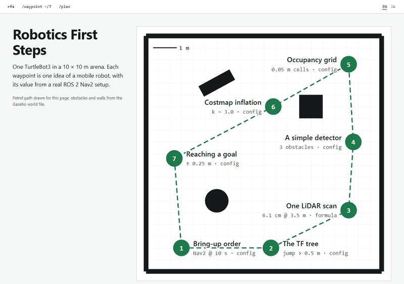

# Robotics First Steps

A mobile robot's first ideas, seen top-down on the floor plan of a real ROS 2 setup: one TurtleBot3 in a 10 × 10 m Gazebo arena. Each waypoint is one idea with one interactive figure, and every value comes from the source repo's files ([TF-Transform-Explorer](https://github.com/AungKaung1928/TF-Transform-Explorer)), cited by file and line.



The GIF is rebuilt from the page check's screenshots: `scripts/verify.sh && python3 scripts/make_demo.py`.

| Waypoint | What you change | What you read |
|---|---|---|
| 1. Bring-up order | SLAM and Nav2 start times; step through the launch (Back / Play / Next) | patrol start (25 s with the launch file's delays); which stage starts before what it needs |
| 2. The TF tree | drift of odom in map, robot pose in odom; odom jump and transform age | one LiDAR hit written in map, odom, base_link, base_scan; the anomaly detector's verdict (stale over 1.0 s, jump over 0.5 m) |
| 3. One LiDAR scan | robot pose, range, scan rate | beams with a return; gap between beams (6.1 cm at 3.5 m); distance moved per scan; measured /scan 4.5–4.8 Hz against 5 Hz configured |
| 4. A simple detector | robot position, break threshold | objects found vs objects in view: 0.1 m gives 6 pieces, 0.5 m the 3 objects (start pose) |
| 5. Occupancy grid | resolution; Add scan from each waypoint | cells in the map (40,000 at his 0.05 m); share of cells no longer unknown |
| 6. Costmap inflation | Nav2 `cost_scaling_factor`, distance to obstacle | cost of the cell (253 inside the 0.22 m radius, 93 at the 0.55 m edge, then 0) |
| 7. Reaching a goal | goal distance | 1.3 cm per 20 Hz control tick at 0.26 m/s; distance left after the 0.25 m tolerance; minimum time and ticks |

## Run

Needs Node 22.12+ (vitest 5 requires it) and, for the page check, Chrome.

```bash
git clone https://github.com/AungKaung1928/robotics-first-steps
cd robotics-first-steps
npm ci
npm run dev          # open the printed localhost URL
npm test             # launch order, ray cast, clustering, occupancy update, transforms, detector rule, time to goal, inflation cost, routes, patrol path
scripts/verify.sh    # builds, loads every page in headless Chrome (EN/JA, 390 px); ends with "PASS 20 pages"
```

## Sources

- Robot, sensor, Nav2 values and the arena: [TF-Transform-Explorer](https://github.com/AungKaung1928/TF-Transform-Explorer) (`description/turtlebot3_burger.urdf.xacro`, `config/nav2_params.yaml`, `worlds/explorer_world.sdf`).
- Inflation cost: [Nav2 InflationLayer](https://docs.nav2.org/configuration/packages/costmap-plugins/inflation.html).
- Units and axes: [REP 103](https://www.ros.org/reps/rep-0103.html).

## License

MIT
