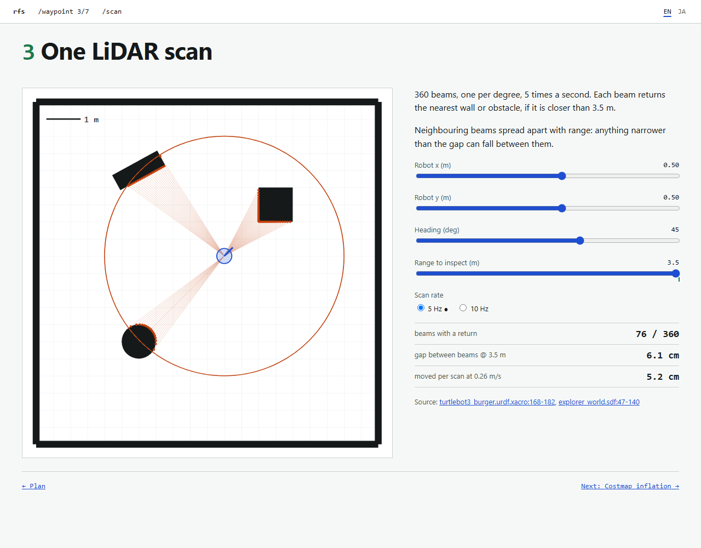

# Robotics First Steps

A mobile robot's first ideas, seen top-down on the floor plan of a real ROS 2 setup: one TurtleBot3 in a 10 × 10 m Gazebo arena. Each waypoint is one idea with one interactive figure, and every value comes from the source repo's files ([TF-Transform-Explorer](https://github.com/AungKaung1928/TF-Transform-Explorer)), cited by file and line.



| Waypoint | What you change | What you read |
|---|---|---|
| 3. One LiDAR scan | robot pose, range, scan rate | beams with a return; gap between beams (6.1 cm at 3.5 m); distance moved per scan |
| 6. Costmap inflation | Nav2 `cost_scaling_factor`, distance to obstacle | cost of the cell (253 inside the 0.22 m radius, 93 at the 0.55 m edge, then 0) |

Five more waypoints (bring-up order, TF tree, a simple detector, occupancy grid, reaching a goal) are on the plan, marked planned.

## Run

Needs Node 22 (CI) or 20.19+ and, for the page check, Chrome.

```bash
git clone https://github.com/AungKaung1928/robotics-first-steps
cd robotics-first-steps
npm ci
npm run dev          # open the printed localhost URL
npm test             # ray cast, inflation cost, routes, patrol path
scripts/verify.sh    # builds, loads every page in headless Chrome (EN/JA, 390 px); ends with "PASS 6 pages"
```

## License

MIT
